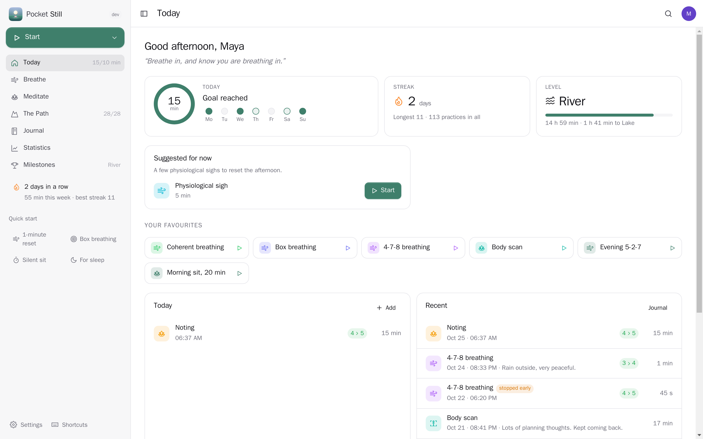
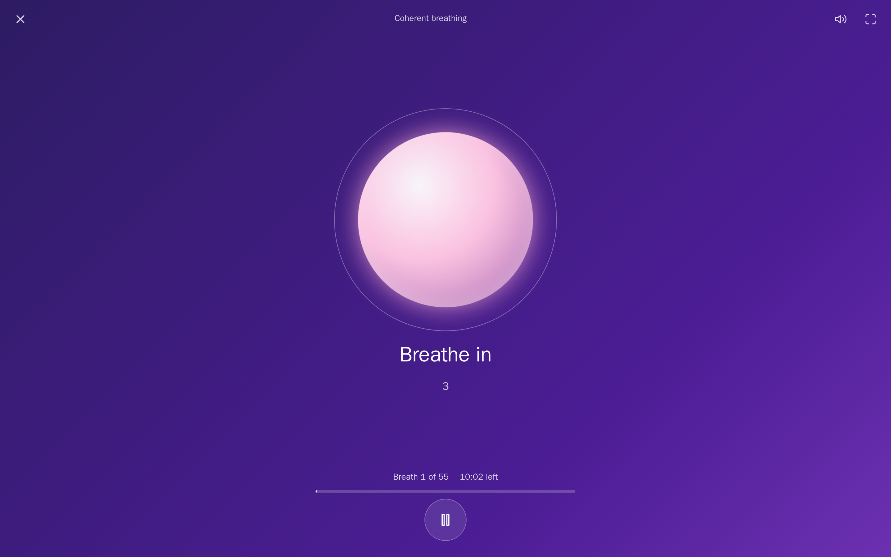
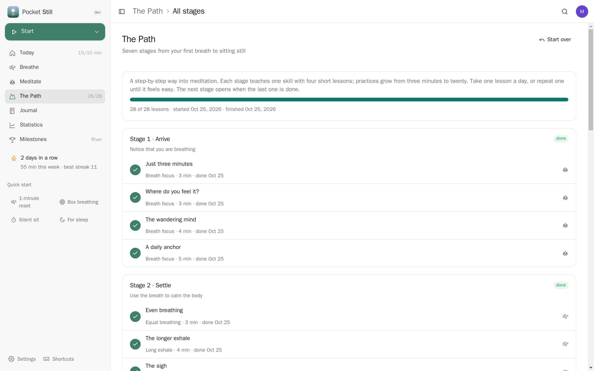
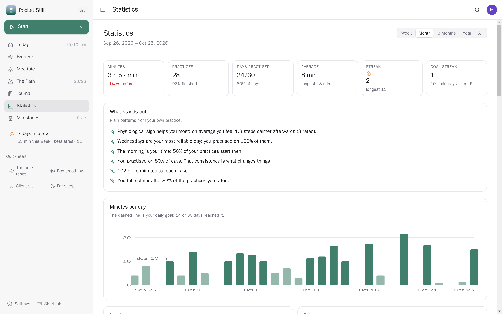
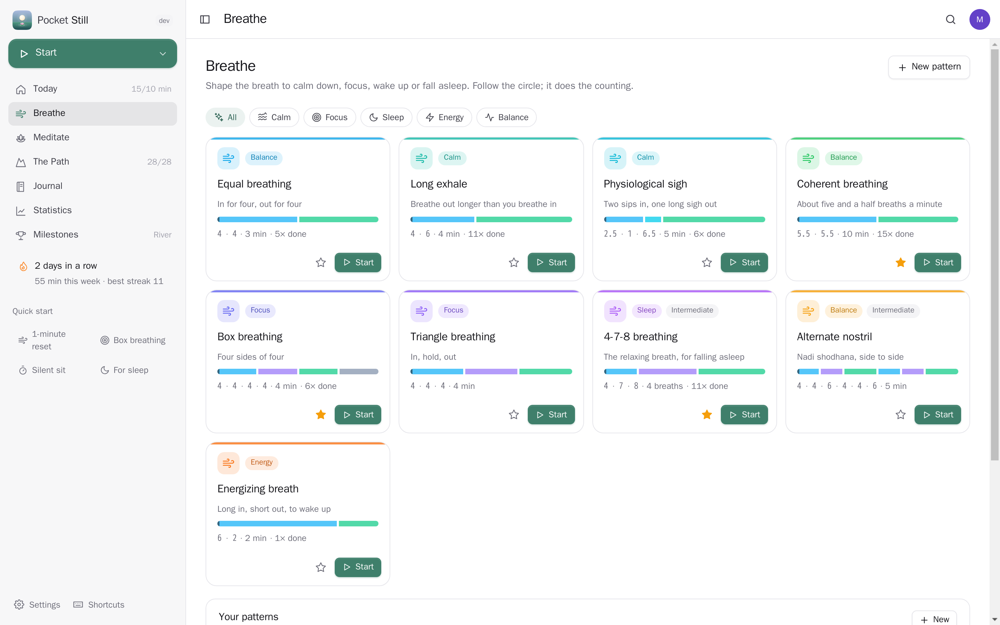
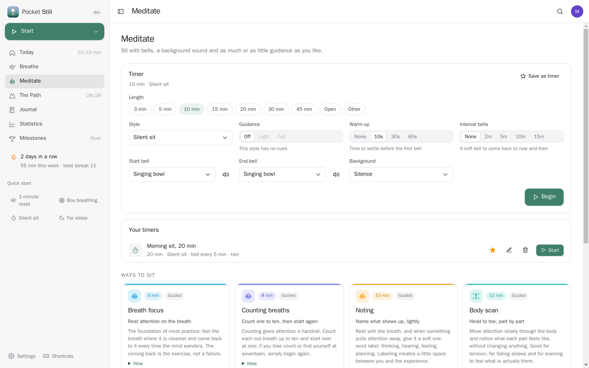
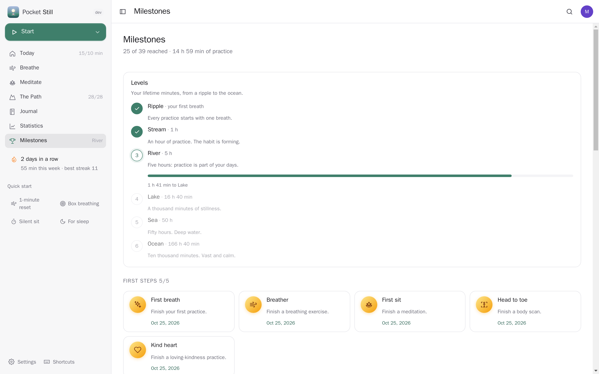
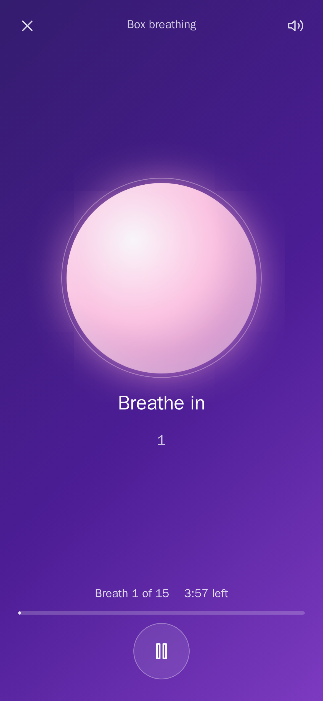
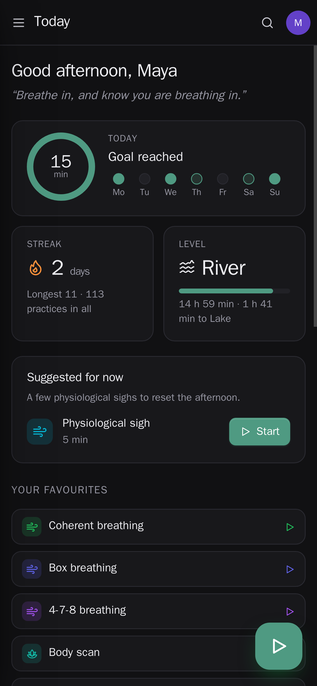

<p align="center"></p>
<h1 align="center">Pocket Still</h1>
<p align="center">Breathe, sit, notice. A breathing and meditation app on your own server: guided breathing patterns with a calm animated guide, a meditation timer with bells, spoken cues and background sounds, the Path — seven stages from your first breath to sitting still in silence — and short courses for breathing, sleep and stress. Every practice lands in a journal with how you felt before and after, and the statistics show what actually helps you: streaks, a year heatmap, the technique that calms you most, your best time of day, levels and milestones. Pocket Health gets your mindful minutes, a day's practice ticks your Pocket Habits habit, Pocket Day and Pocket Calendar show your practice.<br>One Go binary, one SQLite file, one volume. Part of the Pocket apps; works on its own too.</p>
<p align="center">
  <a href="https://github.com/abjelosevic88/pocket-homelab-still/actions"></a>
  <a href="https://github.com/abjelosevic88/pocket-homelab-still/pkgs/container/pocket-homelab-still"></a>
  <a href="LICENSE"></a>
</p>

---

<p align="center"></p>

<table>
  <tr>
    <td width="50%"></td>
    <td width="50%"></td>
  </tr>
  <tr>
    <td align="center"><sub>Breathe along: the orb follows each phase, with soft sounds, voice cues and vibration if you like.</sub></td>
    <td align="center"><sub>The Path: seven stages, four lessons each; the next one opens when you finish a practice.</sub></td>
  </tr>
  <tr>
    <td width="50%"></td>
    <td width="50%"></td>
  </tr>
  <tr>
    <td align="center"><sub>Statistics: minutes, streaks, the year at a glance, how much calmer each technique leaves you.</sub></td>
    <td align="center"><sub>Nine breathing patterns for calm, focus, sleep and energy, plus your own.</sub></td>
  </tr>
  <tr>
    <td width="50%"></td>
    <td width="50%"></td>
  </tr>
  <tr>
    <td align="center"><sub>Meditate: a timer with a warm-up, interval bells and rain, ocean or your own playlist behind it.</sub></td>
    <td align="center"><sub>Levels from Ripple to Ocean, and milestones for streaks, minutes and the Path.</sub></td>
  </tr>
</table>

<p align="center">
  &nbsp;&nbsp;
  
</p>

## What it does

- **Breathe**: box breathing, 4-7-8, coherent (resonance) breathing, the physiological sigh, long exhale, triangle, equal, alternate nostril and an energizing breath, each with what it's good for and how to do it. A full-screen guide (an orb, a box or a wave) follows every phase; soft swells or a bell mark the changes, a voice can say "in" and "out", phones vibrate. Make your own patterns with any phases, holds and labels.
- **Meditate**: a timer with a warm-up, start, interval and end bells (bowl, bell, chime, gong, wood block, all synthesized), background sounds (rain, ocean, stream, brown and pink noise, a fire) or one of your Navidrome playlists, and guided styles: breath focus, counting breaths, noting, body scan, loving-kindness, open awareness, a mindful walk, or a silent sit. Save the timers you use.
- **The Path**: seven stages (Arrive, Settle, Steady, Notice, Feel, Open, Still), four lessons each, a short teaching and one practice, from three minutes of noticing the breath to twenty minutes of silent sitting. Plus courses: Breathe better (7 days), Sleep well (5 nights), Stress reset (5 tools).
- **Journal**: every practice with its length, how calm you felt before and after (1–5), notes and tags; add practices done elsewhere by hand, export to CSV or JSON.
- **Statistics**: minutes per day, week and month, streaks and goal streaks, a year heatmap, consistency, the technique that calms you most, parts of the day and weekdays, session lengths, plain-language insights, and (with Pocket Health) heart rate variability, resting heart rate and sleep on days you practise against days you don't. An AI reflection on your week with Pocket AI or your own OpenAI key.
- **Milestones**: levels by lifetime minutes (Ripple, Stream, River, Lake, Sea, Ocean) and milestones for first practices, streaks, minutes, the Path and courses, early mornings and late nights.
- **Reminders**: at your times on your days (skipped once the day's goal is met), an evening nudge before a streak ends, milestones and a weekly report, through Apprise, ntfy or a webhook.
- **Everyone their own**: each person has their own practice, settings and connections; admins see no one else's.

## Run it

```sh
docker run -d --name pocket-still -p 8080:8080 -v ./data:/data \
  -e BASE_URL=https://still.example.com -e SECURE_COOKIES=true \
  ghcr.io/abjelosevic88/pocket-homelab-still:latest
```

or `docker compose up -d` with [docker-compose.yml](docker-compose.yml). Open it, create the first account and take your first breath. All options: [docs/configuration.md](docs/configuration.md). API: [docs/api.md](docs/api.md).

## With Pocket Core

Set `CORE_URL` and `CORE_REGISTRATION_KEY` and Still joins the box: people sign in with Pocket Core, and through app links each person's practice reaches their own Pocket apps with nothing to paste: mindful minutes into Pocket Health (and heart rate variability, resting heart rate and sleep back for the statistics), a habit ticked in Pocket Habits when the day's practice is long enough, background music from their own Navidrome login, the reflection from Pocket AI. Other Pocket apps can read your practice (`mindfulness:read`: Pocket Day's journal, Pocket Calendar's overlay) or log practices done elsewhere (`mindfulness:write`). Events on the bus: `still.practice_completed`, `still.lesson_completed`, `still.program_completed`, `still.milestone_reached`. Without Core every connection can be made directly with a URL and a token; the Core-only choices stay visible, greyed out.

## Develop

```sh
make dev     # API on :8080 with demo data + Vite on :5173
make test    # go vet, go test, tsc
make         # web + binary
```

MIT licensed. Not medical advice: breathing exercises with long holds or fast breathing can make you light-headed; do them sitting down, never in water or while driving.
